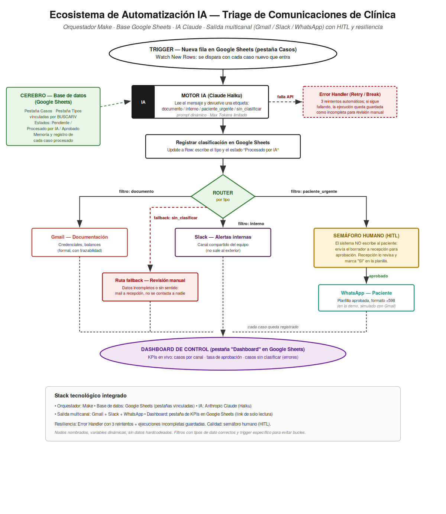

# Ecosistema de Automatización IA — Triage de Comunicaciones de Clínica

**Proyecto Integrador Final — Curso IA Automation**

Autor: Iván Matveychic Presa

Sistema que recibe las comunicaciones de una clínica, las clasifica con IA (Claude), registra cada caso en una base de datos y las deriva al canal correcto (Gmail, Slack o WhatsApp). Antes de contactar a un paciente, se detiene a esperar la aprobación de un humano (HITL).

---

## Enlaces

| Recurso | Enlace |
|---|---|
| Base de datos (Google Sheets, solo lectura) | https://docs.google.com/spreadsheets/d/1kbTBznp1Dtk4btt6cBMJyqfYmWyAc7yIjtWf2E1WSBQ/edit?usp=sharing |
| Dashboard de control (KPIs en vivo) | https://docs.google.com/spreadsheets/d/1kbTBznp1Dtk4btt6cBMJyqfYmWyAc7yIjtWf2E1WSBQ/edit?gid=1421898340#gid=1421898340 |
| Video demo (3 min) | https://drive.google.com/file/d/1Z8jl0Jf15VIA4rnaQdjOk3LptpQa4AVU/view?usp=sharing |

---

## Contenido del repositorio

| Archivo | Descripción |
|---|---|
| `Entrega_final_curso_IA.pdf` | Documento con el diagrama de arquitectura, manual de datos, estrategia de costos y malla de seguridad |
| `blueprint.json` | Lógica del flujo exportada de Make |
| `arquitectura.png` | Diagrama de arquitectura del ecosistema |
| `Capturas_evidencia.pdf` | Capturas de evidencia del flujo funcionando |

---

## Arquitectura

**Flujo:**
1. **Trigger:** nueva fila en la pestaña *Casos* de Google Sheets (Watch New Rows).
2. **Motor IA:** Claude Haiku clasifica el mensaje en `documento`, `interno`, `paciente_urgente` o `sin_clasificar`.
3. **Registro:** el flujo escribe en la planilla el tipo, el estado "Procesado por IA" y la fecha.
4. **Router con filtros:**
   - `documento` → Gmail (documentación formal)
   - `interno` → Slack (alertas al equipo)
   - `paciente_urgente` → aviso a recepción para aprobación (HITL) antes de contactar al paciente por WhatsApp
   - **Ruta fallback** (`sin_clasificar`) → mail de revisión manual, no se contacta a nadie
5. **Resiliencia:** Error Handler (Retry) con 3 reintentos automáticos en el módulo de IA.
6. **Dashboard:** pestaña de Google Sheets con KPIs que se actualizan solos.

**Stack:** Make · Google Sheets · Anthropic Claude · Gmail · Slack · WhatsApp (simulado con Gmail en la demo)

---

## Pruebas realizadas (test de estrés)

| Mensaje de prueba | Clasificación | Resultado |
|---|---|---|
| Enviar credenciales del portal y reglamento | documento | Mail enviado por Gmail |
| Se rompió el aire acondicionado del consultorio 2 | interno | Alerta en Slack |
| Confirmar ayuno para estudio de mañana | paciente_urgente | Aviso de aprobación a recepción (HITL) |
| Recordar cirugía al paciente García | paciente_urgente | Aviso de aprobación a recepción (HITL) |
| "hola" (camino infeliz) | sin_clasificar | Ruta fallback: revisión manual |

> En la primera versión, el mensaje "hola" se clasificaba como "interno" y llegaba a Slack. Se corrigió agregando la categoría `sin_clasificar` al prompt y una ruta fallback en el Router.

---

## Checklist de seguridad

- [x] Filtros que evitan bucles infinitos (el trigger solo toma filas nuevas)
- [x] Filtros que comparan tipos de dato correctos (texto contra texto)
- [x] Prompt de IA dinámico, con variables del sistema
- [x] Semáforo humano (HITL) antes de contactar a un paciente
- [x] API Keys ocultas: no se publican en este repositorio ni en el video
